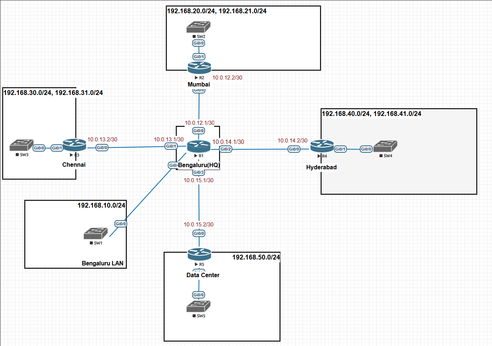
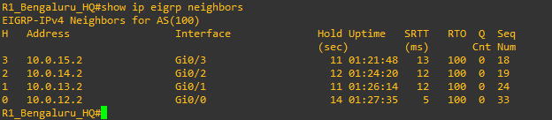
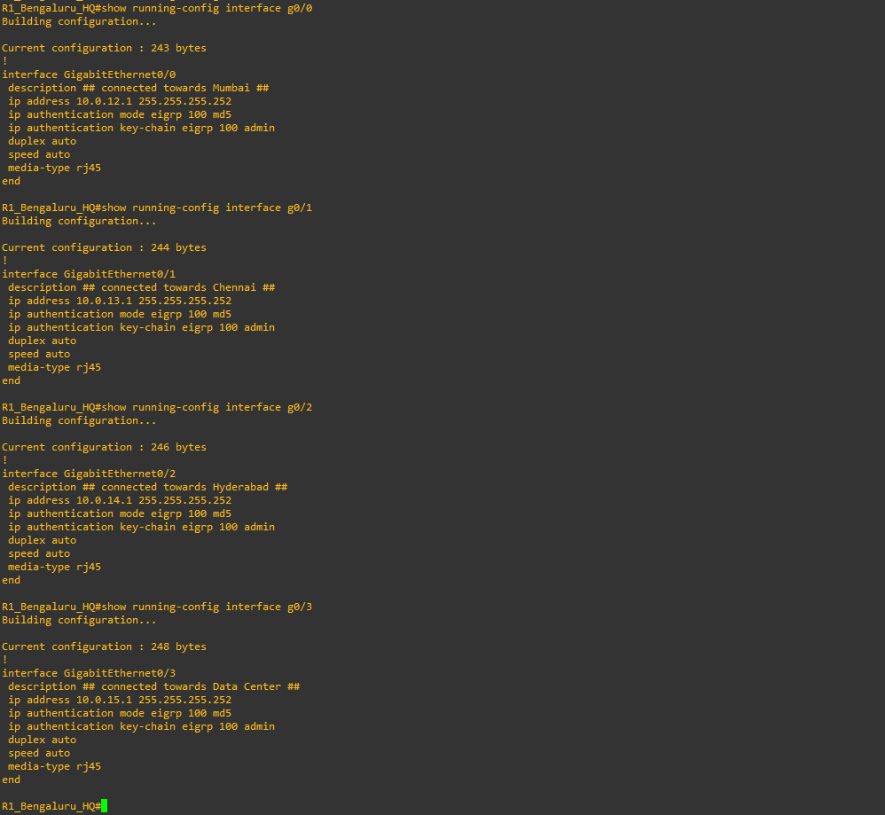
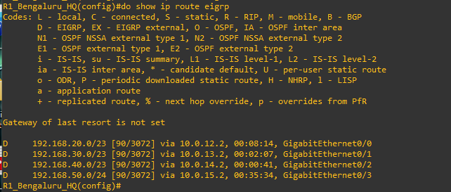
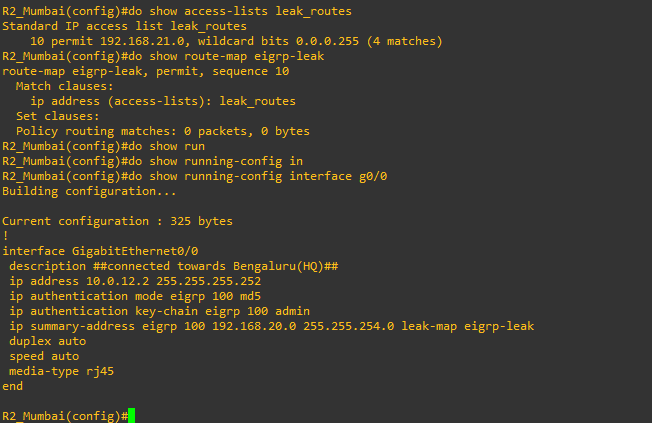
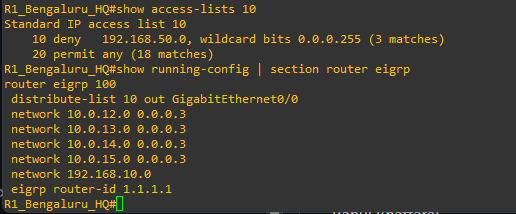
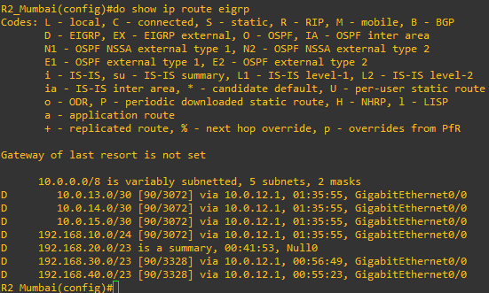

# Enterprise EIGRP Advanced Routing Lab

## Overview
Designed and implemented a multi-branch enterprise network using Cisco EIGRP in an EVE-NG environment.

The lab focuses on advanced EIGRP features, routing security, and route control.

## Network Topology
- R1 – Bengaluru Headquarters
- R2 – Mumbai Branch
- R3 – Chennai Branch
- R4 – Hyderabad Branch
- R5 – Data Center

## Technologies
- Cisco IOS
- EVE-NG
- EIGRP (AS 100)
- VLANs and 802.1Q
- IPv4 Routing

## Features Implemented

**1. EIGRP Authentication**
- Configured MD5 authentication using key chains.

**2. Route Summarization**
- Summarized branch LAN networks to reduce routing table entries.

**3. Route Leaking**
- Implemented EIGRP leak-map to advertise a selected specific route alongside a summary.

**4. Route Filtering**
- Implemented standard ACL-based route filtering using EIGRP distribute-list.

## IP Addressing

| Location | Network |
|---|---|
| Bengaluru | 192.168.10.0/24 |
| Mumbai | 192.168.20.0/24, 192.168.21.0/24 |
| Chennai | 192.168.30.0/24, 192.168.31.0/24 |
| Hyderabad | 192.168.40.0/24, 192.168.41.0/24 |
| Data Center | 192.168.50.0/24 |

## Verification Commands

```cisco
show ip eigrp neighbors
show ip route eigrp
show ip protocols
show access-lists
show route-map
```

## Lab Environment
- Platform: EVE-NG
- Devices: Cisco IOS Routers and Switches
- Routing Protocol: EIGRP AS 100


## Screenshots

### 1. Network Topology


### 2. EIGRP Neighbors


### 3. MD5 Authentication


### 4. Route Summarization


### 5. Route Leaking


### 6. Route Filtering Configuration


### 7. Route Filtering Verification



## Author
Rahul Bhattarai

## Disclaimer
This project was created for educational purposes and hands-on networking practice.
